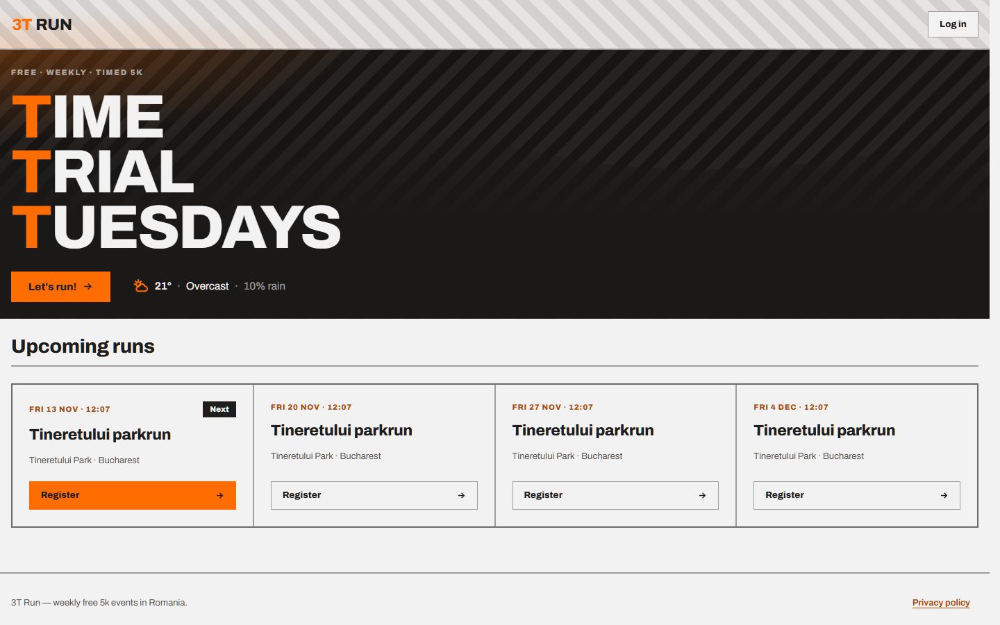
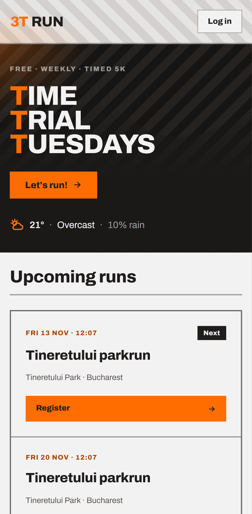
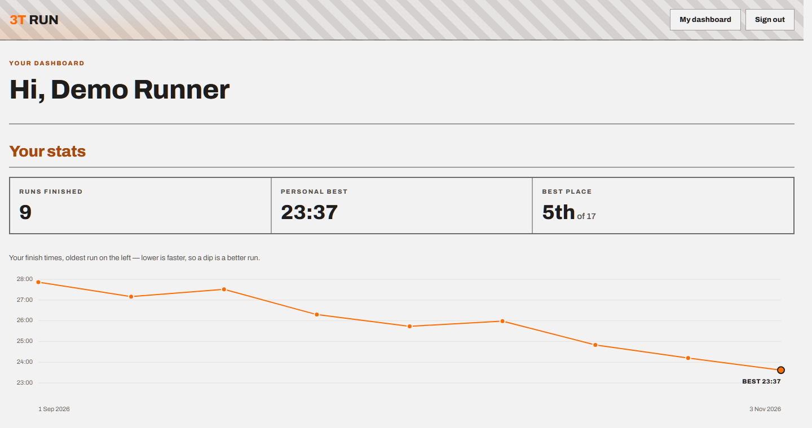
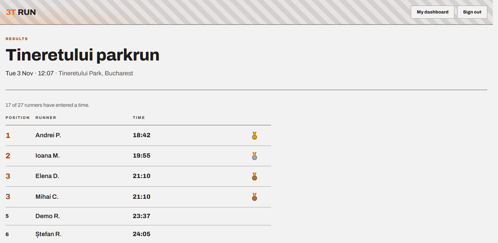

# 3T Run — Time Trial Tuesdays

[](https://github.com/Ovi-codes/3T/actions/workflows/ci.yml)
[](https://github.com/Ovi-codes/3T/actions/workflows/perf.yml)
[](https://github.com/Ovi-codes/3T/actions/workflows/ci.yml)
[](https://github.com/Ovi-codes/3T/actions/workflows/ci.yml)
[](LICENSE)


A full-stack website for free, weekly, timed 5k runs in Romania.
Runners see the upcoming runs, register for one without an account and receive a confirmation
e-mail - core loop. Signed-in runners get a dashboard that shows their
upcoming and past runs, their finish times, their place on each run's leaderboard and
their time trend.

<p align="center">
  
  &nbsp;
  
</p>

| Dashboard: personal stats and time trend | Leaderboard for a past run |
| :---: | :---: |
|  |  |

## Highlights

- **Vertical slices.** Each increment goes through all layers: a Flyway migration, a service,
  a REST API and the Angular UI. The [increment plan](docs/charter.md) and the
  [roadmap](docs/roadmap.md) show the order.
- **Tests at each layer.** JUnit unit tests. Integration tests on a real Postgres in
  Testcontainers. Vitest component tests. Playwright end-to-end tests on desktop and mobile
  viewports, with axe-core accessibility checks.
- **Coverage and formatting in CI.** JaCoCo (backend) and Vitest (frontend) coverage is
  posted to each CI run's summary. Spring Java Format and Prettier fail the build on
  unformatted code. Dependabot opens weekly update PRs for Maven, npm and GitHub Actions.
- **Performance gate.** k6 load tests on the two hot paths are a required check on `main`.
- **Seams at the boundaries.** Authentication and the weather forecast are behind interfaces
  (`AuthProvider`, `WeatherProvider`). Forecasts come from Open-Meteo and are cached with
  Caffeine.
- **Security and GDPR.** Session cookies are `HttpOnly`, `SameSite=Lax` and `Secure`.
  Passwords are hashed with BCrypt. Admin endpoints are restricted to `ROLE_ADMIN`. Runners can
  download their data or delete their account. A privacy policy is published in the app.
- **Ready for the cloud.** All configuration comes from environment variables, and the
  migrations run at startup, so a new database provisions itself. The deploy workflow targets
  Azure App Service and Static Web Apps in an EU region.
- **Decisions are documented.** The [architecture overview](docs/architecture.html) and the
  [architecture decision records](docs/adr/) give the reasons for decisions that are hard to
  reverse.

## Documentation

| Document | Contents |
| :--- | :--- |
| [`docs/charter.md`](docs/charter.md) | Scope, architecture decisions, increment plan, testing strategy, Definition of Done, GDPR |
| [`docs/roadmap.md`](docs/roadmap.md) | V1 / V2 / V3: done, next and later |
| [`docs/architecture.html`](docs/architecture.html) | Architecture overview with diagrams (open it in a browser) |
| [`docs/adr/`](docs/adr/) | Architecture decision records, e.g. [why cancel and delete are different actions](docs/adr/0001-cancel-vs-hard-delete-events.md) |
| [`docs/design/`](docs/design/) | The "Floodlight" design language: per-screen handoff and design tokens |
| [`docs/implementation_details/`](docs/implementation_details/) | Auth, weather and design invariants |
| [`CLAUDE.md`](CLAUDE.md) | Context and conventions for AI coding agents that work on the repo |

## Prerequisites

| Tool | Version |
| :--- | :--- |
| JDK | 21 (LTS) |
| Node | 24 (LTS), 24.15.0 or later — Angular CLI 22 refuses older versions |
| Docker | any recent version, with Compose v2 |
| Git | any recent version |

Check with `java -version`, `node -v`, `docker compose version`.

## Repo layout

```
backend/             Spring Boot (Maven): Web + Data JPA + Flyway + Security
frontend/            Angular (standalone components)
e2e/                 Playwright: tests the whole system (desktop + mobile, a11y)
perf/                k6 load tests, the committed baseline and the gate scripts
docs/                charter, roadmap, architecture, ADRs, design, screenshots
.github              GitHub CI configuration
docker-compose.yml   Postgres + Mailpit for local dev
```

## Run it locally

### 1. Start the local infrastructure

```bash
docker compose up -d
```

This starts:

| Service | Address | Notes |
| :--- | :--- | :--- |
| Postgres 16 | `localhost:5432` | db `runro`, user `runro`, password `runro` |
| Mailpit SMTP | `localhost:1025` | where the app sends mail in dev |
| Mailpit web UI | http://localhost:8025 | read the sent mail here |

Dev credentials are deliberately trivial and local-only — never reuse them anywhere else.

Check both are healthy:

```bash
docker compose ps
```

Stop with `docker compose down`, or `docker compose down -v` to also wipe the database volume.

Mailpit receives the registration confirmation email. After registering for a run
locally, open the Mailpit web UI (http://localhost:8025) to read the message the app sent.

### 2. Backend

```bash
cd backend
./mvnw spring-boot:run
```

Runs on http://localhost:8080. Flyway applies the migrations in
`backend/src/main/resources/db/migration` at startup, so start Postgres first.

Maven itself is not a prerequisite — `mvnw` downloads the pinned version on first use. On
Windows, run `.\mvnw.cmd` instead.

Check it is alive:

```bash
curl localhost:8080/actuator/health
# {"status":"UP"}
```

Database settings come from `DB_HOST`, `DB_PORT`, `DB_NAME`, `DB_USER`, `DB_PASSWORD` and
`SERVER_PORT`.
The confirmation email uses `MAIL_HOST`, `MAIL_PORT`, `MAIL_USERNAME`,
`MAIL_PASSWORD`, `MAIL_SMTP_AUTH`, `MAIL_SMTP_STARTTLS` and `MAIL_FROM`. 
All defaults match the Compose services above, so locally you need none of them; 
a prod SMTP provider sets the mail ones.

The next-run weather forecast calls [Open-Meteo](https://open-meteo.com) (free, no API key,
EU-hosted). It uses `WEATHER_API_URL`, `WEATHER_FORECAST_HORIZON_DAYS` and `WEATHER_CACHE_TTL`.

Admin accounts are named by `ADMIN_EMAILS` (comma-separated; empty by default, so no account is an
admin unless set). A listed account gains `ROLE_ADMIN` the first time it signs up or logs in, which
unlocks event management under `/api/admin/**`.

The account session cookie is `Secure` by default (prod is HTTPS). To sign in over local
**http**, opt out so the browser will store the cookie:

```bash
SESSION_COOKIE_SECURE=false ./mvnw spring-boot:run
```

Anonymous run registration needs no session, so you only need this when exercising accounts.

To demo the leaderboard and personal stats without typing results in, opt into the **demo seed**:

```bash
DEMO_DATA=true SESSION_COOKIE_SECURE=false ./mvnw spring-boot:run
```

It fills the most recent past run with eleven runners and their times, and adds an account that ran
it plus eight weekly runs before it — sign in as `demo@example.com` / `demo-run-5k` to see the time
trend under **Your stats**, and open **Results** on a past run. Off by
default; **never set it in prod**.

### 3. Frontend

```bash
cd frontend
npm install
npm start
```

Runs on http://localhost:4200 and calls the backend at `localhost:8080`.

## Tests

| Layer | Command | Where |
| :--- | :--- | :--- |
| Backend format check + unit + integration + coverage | `./mvnw verify` | `backend/` |
| Backend format fix | `./mvnw spring-javaformat:apply` | `backend/` |
| Frontend lint | `npm run lint` | `frontend/` |
| Frontend / E2E format check (fix: `npm run format`) | `npm run format:check` | `frontend/`, `e2e/` |
| Frontend unit/component | `npm test` | `frontend/` |
| Frontend unit/component + coverage | `npm run test:coverage` | `frontend/` |
| End-to-end (+ axe-core a11y) | `npx playwright test` | `e2e/` |
| Performance gate (k6) | `node perf/scripts/gate.mjs` | `perf/` |

The performance gate load-tests the two hot paths and fails on a p95 regression or a raised error
rate. It needs the stack up and [k6](https://k6.io/) on `PATH` — see
[`perf/baseline.md`](perf/baseline.md) for the numbers, the gate rules, and how to re-baseline.

Coverage reports: the backend writes HTML to `backend/target/site/jacoco/index.html`; the
frontend writes HTML to `frontend/coverage/threet-run/index.html`.

Backend integration tests use Testcontainers, so Docker must be running. They start their own
Postgres — they do not use the Compose one.

E2E tests start the backend and frontend themselves (Playwright's `webServer`), so you only need
Docker up first (`docker compose up -d`) for Postgres and Mailpit — the CS-1 core-loop test reads
the confirmation email back from Mailpit. Install the browser once with
`npx playwright install chromium`.

## Continuous integration

[`.github/workflows/ci.yml`](.github/workflows/ci.yml) runs on every push to `main` and on every
pull request, as three jobs that must all pass:

| Job | Does |
| :--- | :--- |
| `backend` | JDK 21, `./mvnw verify` (Spring Java Format check, unit + Testcontainers integration, JaCoCo). Posts a coverage table to the job summary and uploads the HTML report. |
| `frontend` | Node 24, `npm ci`, Prettier check, `npm run lint`, `npm run test:coverage`. Posts a coverage table to the job summary and uploads the HTML report. |
| `e2e` | Prettier check on the tests, then builds both apps, runs Playwright against the live stack (backed by a Postgres service), and uploads the HTML report as a build artifact. |

[`.github/dependabot.yml`](.github/dependabot.yml) opens weekly update PRs for Maven
(`backend/`), npm (`frontend/` and `e2e/`) and GitHub Actions. Minor and patch updates are grouped
per ecosystem. Angular packages are grouped so that they move together. TypeScript major and minor
updates are ignored, because each Angular release accepts only a narrow TypeScript range. Bump
TypeScript by hand together with Angular.

This is the seed of the release gate: the core-scenario E2E tests (charter §5, CS-1..6) plug into
the `e2e` job as they are built.

A separate [`.github/workflows/perf.yml`](.github/workflows/perf.yml) runs the k6 performance gate
(`gate` job) on the same triggers, and carries a manual `capture` job to re-record the baseline on
the runner. It is a **required status check** on `main`, failing on a p95 over budget (40 ms read /
120 ms write) or a raised error rate (see [`perf/baseline.md`](perf/baseline.md)).

### Deploy

[`.github/workflows/deploy.yml`](.github/workflows/deploy.yml) deploys the backend to Azure App
Service and the frontend to Azure Static Web Apps. It is **manual-only for now** (`workflow_dispatch`)
and does **not** run on merge — Azure is not provisioned yet. The file's header comments carry the
one-time setup checklist (resource group, App Service, Static Web App, Postgres Flexible Server, and
the GitHub secrets) and how to switch it to auto-deploy, gated on green CI on `main`, once that exists.

## Dependencies & versions

Every tool version in the repo is pinned in one of the files below. If you need to bump a
dependency, debug a version clash, or reproduce a build, this is where to look. Nothing is
fetched "latest" at build time — versions change only when one of these files changes.

| File | Controls | Hand-edited or generated? |
| :--- | :--- | :--- |
| `backend/pom.xml` | Spring Boot (via the `spring-boot-starter-parent`), the Java language level, every backend Java dependency, and the build plugins (Spring Java Format, JaCoCo). Third-party versions not listed explicitly are inherited from the Spring Boot parent's managed set. | Hand-edited. |
| `backend/.mvn/wrapper/maven-wrapper.properties` | The Maven version the wrapper downloads and runs, plus the wrapper script version. | Hand-edited (or regenerated by `./mvnw wrapper:wrapper`). |
| `backend/mvnw`, `backend/mvnw.cmd` | The wrapper scripts themselves — they download and invoke the pinned Maven, so contributors don't install Maven by hand. Not versions, but the bootstrap. | Generated by Maven; rarely touched. |
| `frontend/package.json` | Angular, the Angular CLI/build tooling, TypeScript, Vitest, and every other frontend dependency — as **version ranges** (see below). | Hand-edited (directly, or via `ng update` / `npm install <pkg>@<version>`). |
| `frontend/package-lock.json` | The **exact, fully-resolved** frontend dependency tree — every transitive package pinned to a single version with an integrity hash. This is what actually gets installed, and what guarantees your machine and CI are identical. | **Generated** by npm — updates automatically whenever `npm install` resolves the ranges in `package.json`. Commit the result; don't edit by hand. |
| `e2e/package.json` | Playwright (`@playwright/test`) — the E2E runner and browser-download tooling — `@axe-core/playwright` for the accessibility checks the E2E tests run, and Prettier. | Hand-edited. |
| `e2e/package-lock.json` | The fully-resolved Playwright dependency tree (same role as the frontend lockfile, for `e2e/`). | **Generated** by npm; updates automatically on `npm install`. |
| `docker-compose.yml` | The local infrastructure image versions: Postgres and Mailpit. | Hand-edited. |

**Version-range syntax** (in the `package.json` files): `^1.2.3` allows any `1.x.x` (compatible
minor + patch updates), `~1.2.3` allows only `1.2.x` (patch updates), and a bare `1.2.3` would
pin exactly. The **lockfile** records which concrete version those ranges actually resolved to, so
a range only moves when you re-run `npm install` (or `npm update`) and the lockfile is regenerated.

**Not pinned by a file in the repo:**

- **Node and the JDK** — these are your local toolchain, listed under [Prerequisites](#prerequisites)
  and in `CLAUDE.md`, not enforced by a version file. (Node 24 LTS at 24.15.0 or later, JDK 21 LTS.)
- **The Chromium binary Playwright drives** — installed into a shared per-user cache by
  `npx playwright install chromium`, not stored in the repo. Its version is tied to the
  `@playwright/test` version in `e2e/package.json`, so bumping Playwright and re-running the
  install is what updates the browser.

## Contributing

Read the Definition of Done in [`docs/charter.md`](docs/charter.md) §6 before opening a PR.
Work is tracked as GitHub issues under the V1/V2/V3 milestones.

## License

[MIT](LICENSE)
